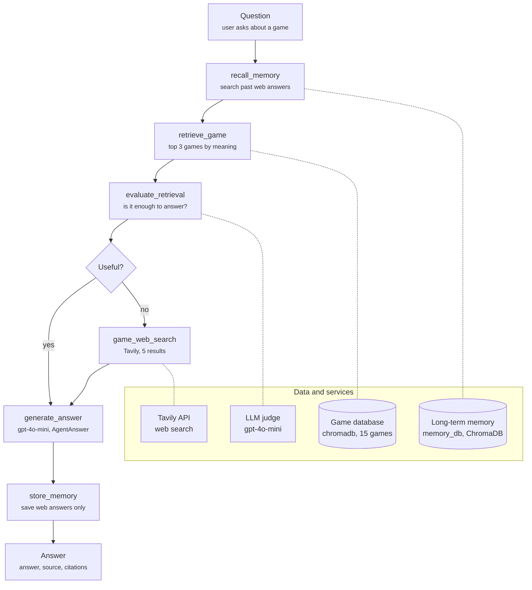

# UdaPlay: AI Game Research Agent — Project Report

*As of 2026-10-11*

## Overview

UdaPlay answers video game questions from a local vector database first and falls back to web search only when that isn't enough; it answered all 3 required test queries correctly, each with a citation.

The project is built in two Jupyter notebooks plus an optional extension:

| Part | Notebook | What it delivers |
| --- | --- | --- |
| 1. Offline RAG | `Udaplay_01_starter_project.ipynb` | 15 game JSON files indexed into a persistent ChromaDB collection, `udaplay`, with OpenAI embeddings |
| 2. Agent | `Udaplay_02_starter_project.ipynb` | A stateful agent with 3 tools: database retrieval, an LLM judge, and Tavily web search |
| Stand Out | `Udaplay_02_starter_project.ipynb` | Long-term memory that persists on disk, and a state-machine agent where each tool is a fixed node |

The agent runs on `gpt-4o-mini` through the Vocareum OpenAI endpoint. Code is on GitHub at `manish5593/Agentic_AI`, branch `main`.

## Architecture

The agent reads two local ChromaDB stores and calls two external services, `gpt-4o-mini` (via Vocareum) and Tavily; every question tries the database before the web.

The left column is the Stand Out state machine, top to bottom; dashed lines show which store or service each step uses. The Part 2 agent follows the same order, but the LLM chooses each tool call, guided by its instructions.

## Part 1: Offline RAG

All 15 games are stored in a persistent ChromaDB collection, and a meaning-based search for "first 3D Mario platformer" returns Super Mario 64 first.

1. **Load:** read every `games/*.json` file in sorted order. Each holds Name, Platform, Genre, Publisher, Description and YearOfRelease.
2. **Format:** build one text per game, `[Platform] Name (Year) - Description`, so the embedding captures platform, title, year and content together.
3. **Store:** `chromadb.PersistentClient(path="chromadb")`, collection `udaplay`, with `OpenAIEmbeddingFunction` pointed at the Vocareum endpoint. The file name (`001` to `015`) is the document ID, and the full JSON is kept as metadata.
4. **Re-runnable:** documents are written with `upsert`, not `add`, so running the cell again updates the 15 records instead of trying to add duplicates.
5. **Verify:** the last cell prints the document count and runs a test search.

Test search result for "first 3D Mario platformer" (lower distance = closer match):

| Rank | Game | Platform | Year | Distance |
| --- | --- | --- | --- | --- |
| 1 | Super Mario 64 | Nintendo 64 | 1996 | 0.1059 |
| 2 | Super Mario World | SNES | 1990 | 0.1343 |
| 3 | Mario Kart 8 Deluxe | Nintendo Switch | 2017 | 0.1867 |

The query never says "Super Mario 64", so the top hit shows the search works on meaning, not keywords. Part 2 loads this same path, collection and embedding function.

## Part 2: Agent and tools

The agent has three tools, and its instructions make it check the database, judge the result, and search the web only when the judge says the database isn't enough.

| Tool | What it does | Returns |
| --- | --- | --- |
| `retrieve_game(query)` | Semantic search over the `udaplay` collection | Top 3 games: Platform, Name, YearOfRelease, Description, distance |
| `evaluate_retrieval(question, retrieved_docs)` | `gpt-4o-mini` as a judge, at temperature 0, with structured output | `EvaluationReport`: `useful` (true/false) and `description` (the reasoning) |
| `game_web_search(question)` | Tavily search, advanced depth, 5 results | Tavily's short answer, plus title, URL and content per page |

Each tool is a Python function wrapped with `lib.tooling.tool`, which turns its type hints and docstring into an OpenAI tool schema. Every tool catches its own errors and returns them as data, so one failed API call doesn't crash the agent.

**Agent:** `lib.agents.Agent` with `gpt-4o-mini` at temperature 0 and all three tools. Internally it is a state machine: prepare messages → call the LLM → run any tool calls → back to the LLM, until no tools are requested.

**Instructions** tell it to:

1. Always call `retrieve_game` first.
2. Call `evaluate_retrieval` on the results.
3. Answer from the database if useful, otherwise call `game_web_search`.
4. Never make up facts.
5. End with a Source line: `Internal database: <Name> (<Platform>, <Year>)` or the web page URLs.

**Conversation state:** the agent keeps each session's message history in `ShortTermMemory`. A new question in the same `session_id` sees the earlier turns, so follow-ups like "what platform was it released on?" resolve "it" correctly.

## Results

All 4 queries were answered correctly with a citation: 2 from the database, 1 through web fallback, and 1 follow-up from conversation memory with no tool calls.

| # | Query | Tools used | Judge's verdict | Final answer | Citation |
| --- | --- | --- | --- | --- | --- |
| 1 | When was Pokémon Gold and Silver released? | `retrieve_game` → `evaluate_retrieval` | Useful | 1999, on Game Boy Color | Internal database: Pokémon Gold and Silver (Game Boy Color, 1999) |
| 2 | Which one was the first 3D platformer Mario game? | `retrieve_game` → `evaluate_retrieval` | Useful | Super Mario 64, Nintendo 64, 1996 | Internal database: Super Mario 64 (Nintendo 64, 1996) |
| 3 | Was Mortal Kombat X released for PlayStation 5? | `retrieve_game` → `evaluate_retrieval` → `game_web_search` | Not useful | No. Released for PS4 on April 14, 2015; playable on PS5 through backward compatibility and the PlayStation Plus Collection | [mortalkombatonline.com](https://www.mortalkombatonline.com/t/mkx/ps5-playstation-plus-collection-to-include-mortal-kombat-x/85LJ3iL2YW7V) |
| 4 | And what platform was it released on? *(follow-up to #2)* | None | n/a | Nintendo 64 | Internal database: Super Mario 64 (Nintendo 64, 1996) |

**Why query 3 fell back to the web:** the database had no Mortal Kombat X record. Its closest PS5 matches were Marvel's Spider-Man 2, Marvel's Spider-Man and Halo Infinite, and the judge rejected them as unrelated.

**How it reports each query:** the notebook prints this turn's tool calls with their arguments, the judge's reasoning, and the final answer with its Source line. Wording varies slightly between runs; the facts and tool paths stay the same.

## Stand Out: memory and state-machine agent

Asked the Mortal Kombat X question a second time, the Stand Out agent answered from long-term memory and skipped the web search.

**Long-term memory.** `lib.memory.LongTermMemory` stores data in memory only, unless it gets a persistent ChromaDB client. Here it gets one at `persist_path="memory_db"`, so memories survive kernel restarts. Only web-sourced answers are saved, as `Q: … A: … (sources: …)`, because database answers are already known.

**Tools as fixed nodes.** Instead of the LLM choosing which tool to call, each tool is a step in `lib.state_machine.StateMachine`, and the transitions encode the workflow. The architecture diagram above shows the flow. The only branch is after `evaluate_retrieval`: useful goes straight to `generate_answer`; not useful goes through `game_web_search` first.

**Structured output.** `generate_answer` returns a Pydantic `AgentAnswer` with three fields: `answer`, `source` (`internal_database`, `long_term_memory`, `web_search` or `unknown`), and `citations`.

| Run | Path | Source |
| --- | --- | --- |
| Mortal Kombat X, first time | recall_memory → retrieve_game → evaluate_retrieval → **game_web_search** → generate_answer → store_memory | web_search, 2 URLs |
| Mortal Kombat X, second time | recall_memory → retrieve_game → evaluate_retrieval → generate_answer → store_memory | long_term_memory, same 2 URLs |

The demo clears its own memories at the start of each run, so results are reproducible; commenting out that line keeps what earlier sessions learned.

## Rubric coverage

Every submission requirement is met; the table shows where to find each one.

| Criterion | Requirement | Where it is met |
| --- | --- | --- |
| Prepare local dataset | Notebook loads, processes and formats the game JSON files | Notebook 1, "Add documents" cell |
| Prepare local dataset | Data added to a persistent vector DB with embeddings | Notebook 1: `PersistentClient`, OpenAI embeddings, `udaplay` collection; `chromadb/` committed |
| Prepare local dataset | Vector DB can be queried for semantic search | Notebook 1, last cell: count 15 and the Mario test search |
| Agent tools | Tool to retrieve from the vector DB | `retrieve_game` |
| Agent tools | Tool to evaluate retrieved results | `evaluate_retrieval`, with `EvaluationReport` |
| Agent tools | Tool for web search via an API | `game_web_search`, Tavily |
| Agent tools | Internal first, evaluate, then web fallback | Results queries 1 to 3 |
| Stateful agent | Class that keeps conversation state | `Agent` with `ShortTermMemory` sessions |
| Stateful agent | Multiple queries in a session, remembering context | Results query 4, a follow-up with no tool calls |
| Stateful agent | Workflow as a state machine | `lib.state_machine.StateMachine`; Stand Out agent with tools as nodes |
| Stateful agent | Clear, structured, cited answers | Source line on every answer; `AgentAnswer` in Stand Out |
| Demonstrate and report | At least 3 example queries | 3 required queries plus 1 follow-up |
| Demonstrate and report | Output shows reasoning, tool usage and final answer | Notebook 2 query cell prints all three per query |
| Demonstrate and report | Report with cited responses | Report cell in Notebook 2, and this document |

## Challenges, limitations and next steps

The main problems were environment issues rather than agent logic, and the biggest limitation is the 15-game database.

**Challenges solved**

| Problem | Cause | Fix |
| --- | --- | --- |
| Notebook cells failed in PyCharm but ran from the terminal | PyCharm used a standalone Python 3.11 without the project's packages | Switched the interpreter to the project's `.venv` (Python 3.12) |
| `NotFoundError: Collection ... does not exist` in the Stand Out cells | `reset=True` deletes and recreates the memory collection, breaking any other kernel holding the old ID | Clear the stored memories instead of dropping the collection, then restart the kernel |
| Re-running the indexing cell would re-add the same 15 IDs | `collection.add` only inserts; it never updates existing records | Switched to `collection.upsert`, which inserts or updates |
| API keys pasted into notebook cells | Keys would be published on GitHub | Keys kept only in `.env` (git-ignored); notebooks hold placeholders |

**Limitations**

- Only 15 games are indexed, so most real questions depend on web search quality.
- The LLM judge can be wrong in either direction: it may accept a close-but-wrong game, or reject a useful one.
- LLM wording varies between runs, though facts and tool paths were stable in testing.
- Long-term memory saves web answers without checking them, so a wrong web answer would be remembered.

**Next steps**

- Index a larger game dataset and add metadata filters (platform, year, publisher) to `retrieve_game`.
- Save useful web results into the `udaplay` collection itself, not only into memory.
- Add an evaluation set of questions with known answers to measure accuracy and fallback rate.
